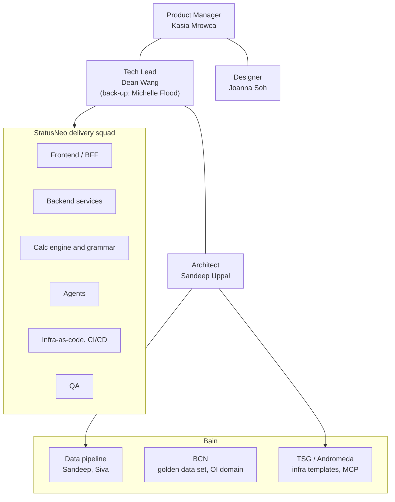
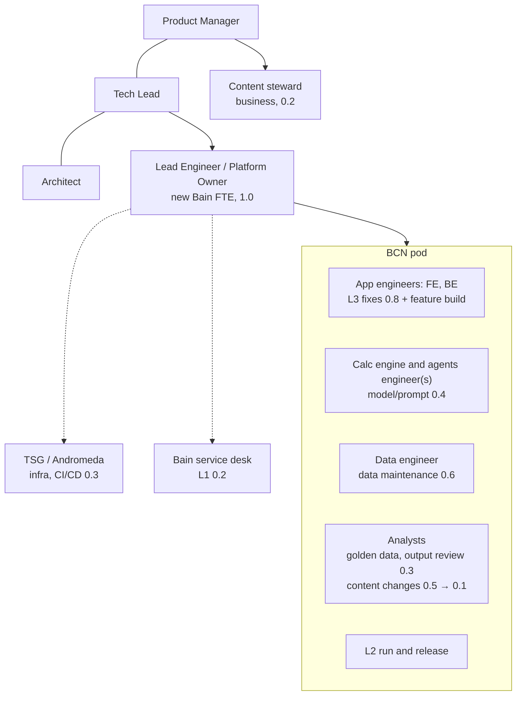
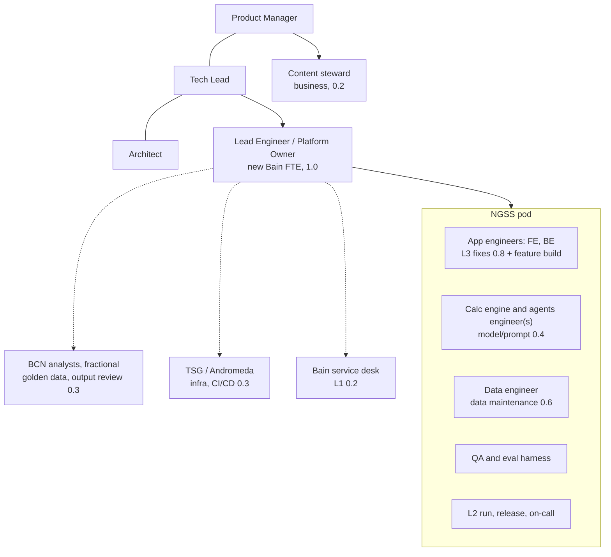
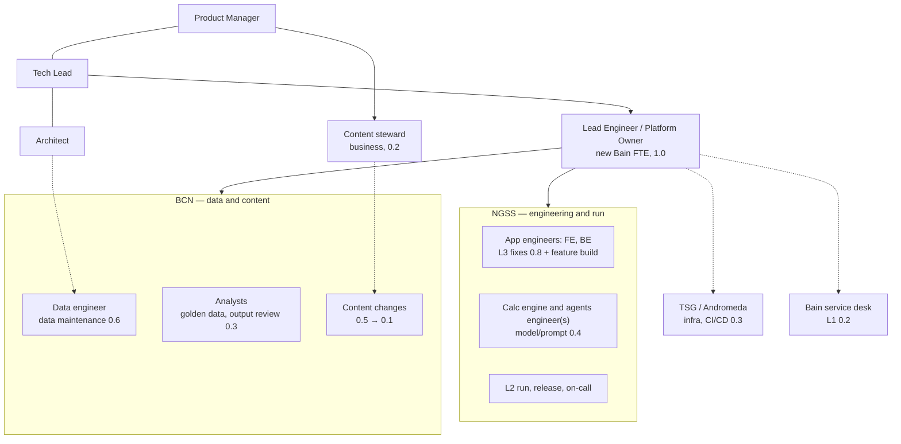
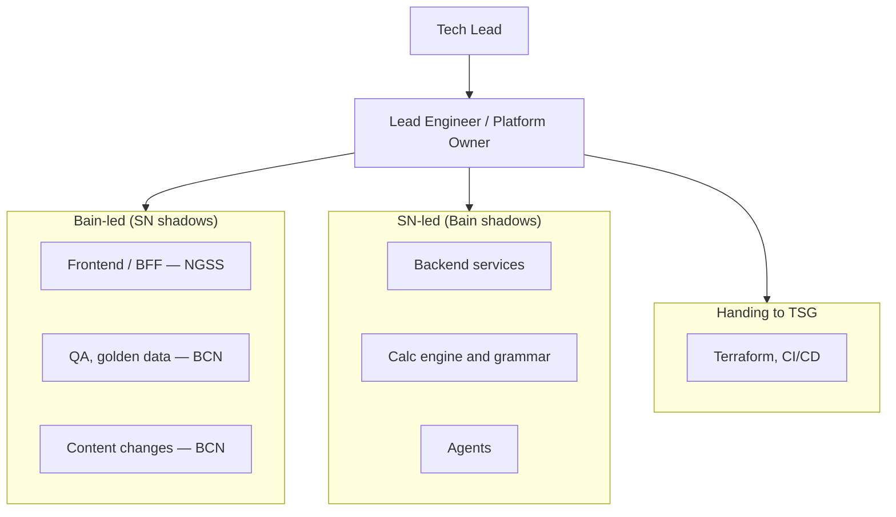
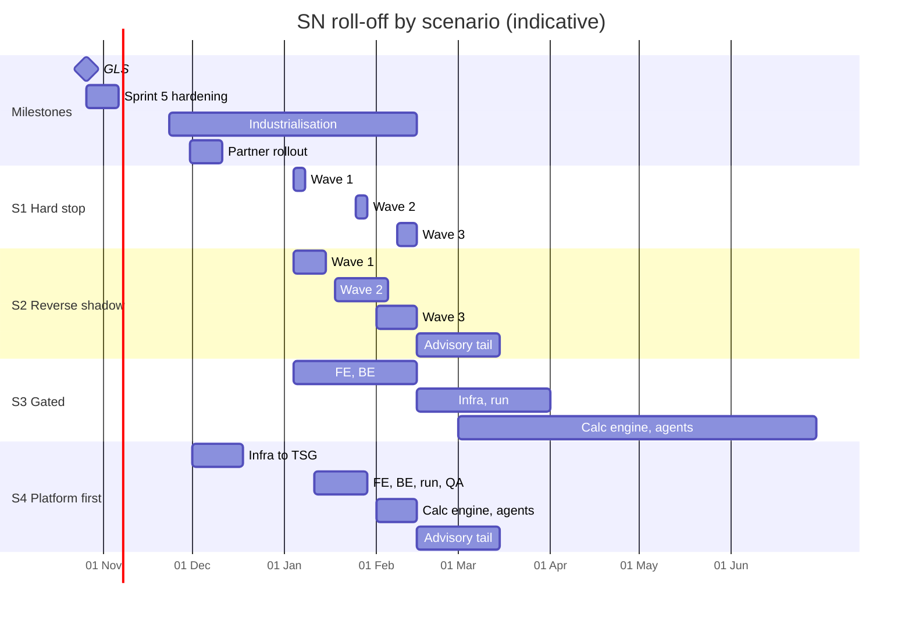

# Post-GLS team structure: transition from StatusNeo to Bain internal (PROPOSAL)

*Recommendation for the Tech Lead to sign off. Refreshed 26 Oct 2026 (GLS day) against the mirror and the knowledge base as of the Sprint 3 retrospective. First drafted 23 Oct. Headcounts, SOW terms and NGSS/BCN capacity are not in the mirror. Where a figure appears below it comes from `decisions/003` (proposed) and is marked as an estimate.*

## What changed since the 23 Oct draft

| Then | Now | Source |
| --- | --- | --- |
| Narrative agent not built | **Built in Sprint 3**, with the chat assistant agent and tool catalogue | [Sprint 3 Retrospective](https://bainco.atlassian.net/wiki/spaces/OI30/pages/19933790220) |
| Data integrations treated as SN-held, highest risk | **The data pipeline is Bain-led** (Sandeep, Siva). SN leads the agent layer. Golden data set **curated with BCN** | [VCC overview meeting](../confluence/oi30/meeting-summaries/vcc-overview-meeting-19696746551.md); Sprint 3 retro |
| Platform and run left open between BCN and NGSS | **Infrastructure and CI/CD are Bain-owned already**: *"DevOps, cloud infrastructure, and CI/CD pipelines are Bain-owned"*. Platform goes to TSG/Andromeda in every option | [Andromeda](../confluence/oi30/ways-of-working/onboarding-statusneo/andromeda-bains-agentic-ai-platform-19691733117.md) |
| No prior staffing position | `decisions/003` (proposed 15 Sep) recommends **one Bain Lead Engineer FTE plus an SN run pod**. A JD for that role was drafted 23 Sep. Both sit on branch `claude/tool-ops-staffing-plan-64hj38`, unmerged | that branch |
| ADR ownership finding open | OI3-27 closed in Sprint 3 | Sprint 3 retro |
| Timeline after GLS unclear | Sprint 5 *"Support and Hardening"* runs 26 Oct – 6 Nov | `OC3_Stakeholder_Update_Sprint3_final.pptx`, slide 3 |

### This reverses part of decisions/003, and that should be said plainly

`decisions/003` rejected *"Build a Bain-internal run team"* because *"the working knowledge of the calculation engine, the expression parser and the agent swarm sits with the people who wrote them. Rebuilding that knowledge costs more than renting it."* The direction now is to move ownership to BCN or NGSS and roll SN off. Everything else in 003 carries over: the one accountable Bain owner, the four change classes, the support tiers, and what temporary staff must never own. Only one line changes. **The SN run pod becomes a BCN and/or NGSS pod**, and reverse shadowing is how the knowledge transfer 003 priced gets paid for. If you accept this proposal, 003 should be amended to match before it is merged.

## Facts the plan rests on

| Fact | Source |
| --- | --- |
| GLS 26 Oct. Sprint 5 Support and Hardening 26 Oct – 6 Nov | Sprint 3 stakeholder deck |
| Industrialisation from ~23 Nov 2026, ~12 weeks (to ~15 Feb 2027), separate SOW | [Onboarding - StatusNeo](../confluence/oi30/ways-of-working/onboarding-statusneo-19640975400.md) |
| 50+ partner rollout late Nov / early Dec | [GLS Deployment Tracker](../confluence/oi30/architecture/opportunity-catalyst-architecture-high-level/deployment-design-ai-compute-data-components-cicd/oc-dev-staging-gls-deployment-tracker-19909279789.md) |
| Bain roles today: Tech Lead (Dean), PM (Kasia), Architect (Sandeep), Designer (Joanna), Tech Lead back-up (Michelle) | Onboarding page |
| SN capacity was already short: *"No data engineer was onboarded for the GLS sprints"* | Sprint 3 retro, slide 8 |
| Run envelope after MVP estimated at **≈5.3–5.8 FTE-e**, of which 1.0 is new Bain headcount | `decisions/003` (estimate, pending an availability target) |

**Still not in the mirror:** what NGSS is and what it runs today, SN headcount by role, SOW notice terms, BCN capacity, and the Lead Engineer hire status.

## Workstreams and knowledge risk

| # | Workstream | Who holds it today | Knowledge risk on SN roll-off |
| --- | --- | --- | --- |
| 1 | Frontend (React/TS/Vite), BFF | SN | Low to medium. Contract and boundary tests landed in Sprint 3 |
| 2 | Backend services (case, audit, document upload, FastAPI/FastMCP) | SN | Medium. Services tested in Sprint 3 |
| 3 | Calculation engine, expression grammar, definition registry | SN | **High.** `decisions/003` calls this the one thing that "cannot be handed over to someone who did not build it" |
| 4 | Agents (peer selection, narrative, chat assistant) | SN (Part 2) | **Highest.** Model positions unrecorded, and serpapi is unruled |
| 5 | Data pipeline and integrations | **Bain** (Sandeep, Siva), with BCN on the golden data set | Medium. No data engineer, and live sources are not connected yet |
| 6 | Infra, CI/CD, Terraform, identity | SN-built on Bain templates; Bain-owned by rule | Medium. The deployment tracker is well documented |
| 7 | QA, eval harness, golden data set, release output review | SN QA, plus BCN for golden data | Medium |
| 8 | Security and governance (OI3-21) | Tech Lead review | Unknown. Four design pages still blank |

## Org charts

Boxes are roles, not named people, except where the mirror names the person. FTE-e figures come from `decisions/003`'s run envelope and are estimates. Post-GLS feature build (the nine initiatives on [Post GLS feature set](../confluence/oi30/post-gls-feature-set-19800162379.md)) sits **on top of** the run envelope, and its size depends on what is funded.

### Today (Sprint 5, Support and Hardening)

### Option A: BCN owns build and run

- **For:** one accountable team, closest to the domain, and BCN already co-owns the golden data set.
- **Against:** BCN takes on production engineering, L2 run and incident duty. The mirror shows no evidence BCN does that today. Agent engineering is the skill furthest from BCN's current work.

### Option B: NGSS owns build and run

- **For:** one engineering team, and probably the stronger run discipline. That second point is an assumption, because the mirror says nothing about NGSS.
- **Against:** domain knowledge has to be rebuilt. BCN stays involved for the golden data set anyway, so in practice this is two teams with one of them informal.

### Option C: split — NGSS engineers, BCN owns data and content

- **For:** each team does what it already does. BCN keeps the domain, the golden data set and the class 1 and class 2 changes from `decisions/003`. NGSS takes code and incidents. The data pipeline stays on the Bain side where it already sits.
- **Against:** two teams means an interface to govern. Data repairs often need code changes, so a class 2 change crosses both teams. The Lead Engineer is the single point holding them together.
- **Changed from the 23 Oct draft:** agents moved from BCN to NGSS. Agent work is engineering, and the VCC meeting describes it as *"where specialist AI expertise is genuinely needed"*.

### Transition state (Scenario 2, mid-January)

What the chart looks like between Wave 1 and Wave 3 under the recommended scenario. This version uses Option C.

## Roll-off scenarios

Every scenario starts with **Wave 0 (now to 23 Nov)**: name the receiving teams, push the Lead Engineer hire, and put Bain shadows into Sprint 5 hardening. Nobody rolls off before the 50+ partner rollout has settled. That rollout falls in Industrialisation weeks 1–2. The holiday period removes about two working weeks from late December. That's my judgment, not a documented constraint, but every wave below allows for it.

### Scenario 1: Hard stop at SOW end

| Wave | When | Workstreams off SN |
| --- | --- | --- |
| 1 | early Jan | 1 frontend, 7 QA |
| 2 | late Jan | 2 backend, 6 infra to TSG |
| 3 | ~15 Feb | 3 calc engine, 4 agents |

Fastest and cheapest. Calc engine and agents get about four effective weeks of shadowing. Not recommended unless the SOW cannot move.

### Scenario 2: Three waves with reverse shadowing (recommended)

Each workstream goes through three steps: SN leads with Bain shadowing, then Bain leads with SN shadowing, then SN is gone.

| Wave | Bain leads from | SN off | Workstreams |
| --- | --- | --- | --- |
| 1 | early Jan | mid Jan | 1 frontend, 7 QA, content changes |
| 2 | mid Jan | early Feb | 2 backend, 6 infra to TSG, L2 run |
| 3 | early Feb | ~15 Feb | 3 calc engine, 4 agents |
| Tail | — | ~15 Mar | Advisory retainer for 3 and 4 only. Bounded hours, hard end date |

Data (5) is not a wave because it is already Bain-led. The data engineer SN never onboarded should be hired by Bain directly, not by SN.

### Scenario 3: Capability-gated (closest to decisions/003)

SN roles roll off when a gate is met, not on a date. The gates:

- Bain ships one monthly release train alone with no P0 defect.
- A Bain engineer who did not write the calc engine makes a change to it, which is 003's bus-factor test.
- A model version change passes regression without SN.

Frontend and backend go first and agents last, likely around Q2 2027. In effect this is 003's SN run pod, wound down. It costs the most and has the lowest risk. Use it if the receiving team cannot be staffed by January.

### Scenario 4: Platform first, then by team (Option C only)

- Infra and CI/CD go to TSG in early Dec. The Andromeda page already makes them Bain-owned, and the deployment tracker is the best-documented area.
- NGSS takes frontend, backend and run in mid Jan. BCN takes QA and content at the same time.
- Calc engine and agents go to NGSS in mid Feb, with the Scenario 2 tail.

It moves the earliest work to the team with the clearest mandate. It needs TSG capacity in December, during the partner rollout.

## Comparison

| | S1 Hard stop | S2 Reverse shadow | S3 Gated | S4 Platform first |
| --- | --- | --- | --- | --- |
| SN fully off | ~15 Feb | ~15 Mar | ~Q2 2027 | ~15 Mar |
| Handover risk | High | Medium | Low | Medium |
| SOW change | None | Small extension | Large extension | Small extension |
| Bain staffing needed by | Dec | Dec (Lead Engineer), Jan (pod) | Feb | Dec (TSG), Jan (pod) |
| Works with | A, B, C | A, B, C | A, B, C | C |

**Recommendation:** use **Scenario 2 with Option C**. If NGSS cannot take production engineering, fall back to **Option A**, with the Lead Engineer carrying more of the engineering until BCN builds it up.

## Preconditions for any scenario

1. **Hire the Lead Engineer before Wave 1.** Every option hangs off this role. The JD has been in draft since 23 Sep. If the hire is not in seat by early January, every scenario becomes Scenario 3.
2. **Name a Bain owner for the calc engine and the agents** before any SN engineer on them leaves.
3. **Fill the four blank design pages** (Security, NFR, Observability, Endpoints) before Wave 2. A Bain team cannot run to a standard that has not been written. `decisions/003` already calls Observability a run blocker.
4. **Close the three "Angel to confirm" items and move off the POC Foundry account** before infra goes to TSG.
5. **Rule on serpapi and record model positions** before the agents move. The receiving team should not inherit unapproved vendors.
6. **Amend `decisions/003`** to replace the SN run pod with the chosen option, then merge it.

## Inputs I need to firm this up

1. What NGSS is, what it runs today, and what capacity it has from January.
2. BCN capacity, and whether BCN is willing to take L2 run (this decides between Options A and C).
3. SN headcount by workstream, and the SOW notice terms for partial roll-off.
4. Where the Lead Engineer hire stands.
5. Whether the Industrialisation SOW (from ~23 Nov, ~12 weeks) and the partner rollout date still hold.

## Sign-off

This is a recommendation. The Tech Lead decides the scenario and the ownership model. The ruling goes in `decisions/`, as an amendment to 003.
